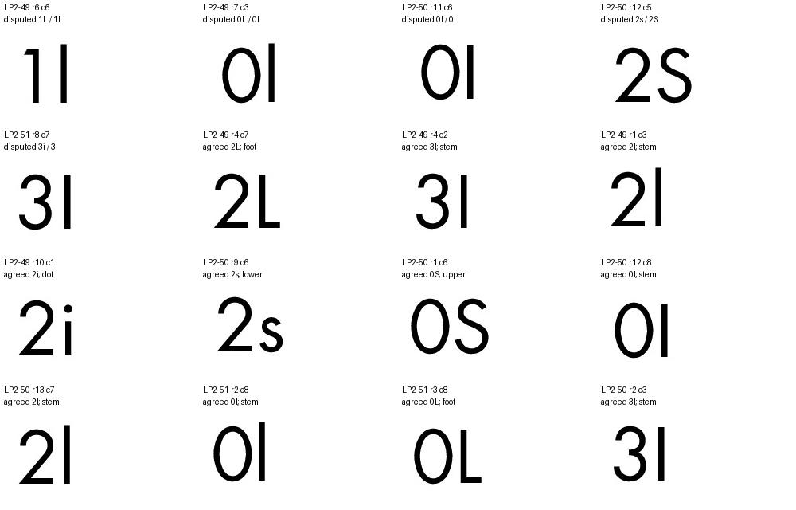

# Siebte Forschungsserie: Glyphenprüfung, Zahlentabellen und Rückkopplung

Stand (UTC): 2026-10-19T17:56:16.716925+00:00. **Keine neue Entschlüsselung bestätigt.**

## E023: Fünf Quellenkonflikte am Bild geprüft

16 unvergrößerte Ausschnitte aus den gepinnten Bildern liefern Vergleichszeichen.
Die fünf strittigen Zellen stützen folgende Lesarten:

| Seite | Zeile, Spalte (ab 1) | Bildgestützte Lesart | Base60-Wert |
|---|---|---|---|
| LP2-49 | 6,6 | `1l` | 107 |
| LP2-49 | 7,3 | `0l` | 47 |
| LP2-50 | 11,6 | `0I` | 18 |
| LP2-50 | 12,5 | `2S` | 148 |
| LP2-51 | 8,7 | `3I` | 198 |

Kleines `l` hat in den geprüften Ausschnitten 73–74 Pixel Höhe, großes `I` 67.
Großes `L` besitzt einen Fuß; kleines `i` einen getrennten Punkt. Das strittige
`S` hat 69–71 Pixel Höhe, das Vergleichs-`s` 44–45. Messungen bei drei
Helligkeitsschwellen (32/128/224) stützen den visuellen Vergleich. Die Schwellen
wurden nach der ersten Bildansicht als Empfindlichkeitsprüfung festgelegt;
dies ist kein vorab validierter automatischer Zeichenerkenner.



[Koordinaten und Prüfsummen](../sources/glyph_crop_manifest.json),
[Beobachtungen](../sources/glyph_observations.json). Die Ausschnitte wurden nicht
resampelt oder nachgeschärft. Quellenbilder und kanonische Transkription bleiben
unverändert. Die separate Korrekturschicht ergibt dieselben Tokens wie die schon
vorhandene iddqd-Transkription; dies ist eine Quellenprüfung, keine neue Entzifferung.
Alle historischen Alternativen bleiben erhalten. Ein einzelner visueller Leser,
keine zweite unabhängige Bildlesung und keine vollständige Neutranskription aller
256 Zellen. Die neun E022-Dezimalinkonsistenzen bleiben als historischer Befund bestehen.

## E024: Begrenzte Strukturprüfung der 256 Werte

Base60 bleibt replizierte Vorarbeit. Die explizite Reihenfolge lautet LP2-49,
LP2-50, LP2-51, jeweils zeilenweise von links nach rechts. Jede Zahl ist mit
Seite, Zeile, Spalte und Token zurückverfolgbar und reversibel kodiert.
Bytefolge SHA-256: `3b9b07d9a26e6d55c432d94d2661fdff3c2b348daed06821f2bdb23184a4b290`.

161 verschiedene Werte, 127 gleiche ungeordnete Wertepaare, keine gleichen
Nachbarwerte. Die empirische Entropie beträgt 7.169655 Bit;
dieser endliche Stichprobenschätzer ist kein Test kryptographischer Zufälligkeit.

Vier vorab festgelegte Statistiken wurden mit 9.999 IID-gleichverteilten Bytefolgen
verglichen (Seed 3301024). Alle vier Statistiken werden in jedem Zufallslauf
berechnet; Bonferroni-Faktor 4, Bitmaximum bereits innerhalb jedes Laufs ausgewählt.

| Statistik | Roh-p | Korrigiertes p |
|---|---|---|
| collision_deviation | 1.0000 | 1.0000 |
| adjacent_repeat_deviation | 0.6362 | 1.0000 |
| max_bit_imbalance | 0.9663 | 1.0000 |
| column_sum_dispersion | 0.2879 | 1.0000 |

Die vier vorgesehenen positiven Kontrollprüfungen bestehen. Keine auffällige
Abweichung in diesen Tests; daraus folgt weder Verschlüsselung noch Zufälligkeit,
Dateityp oder Schlüssel. Keine Statistik auf den unbekannten Daten nachoptimiert.

## E025: Affine Klartext-Rückkopplung mit Abstand zwei

Regel: `P_i = a*C_i + b*P_(i-2) mod 29`, mit zwei freien Anfangswerten.
Alle a,b von 1 bis 28, ohne vier schon in E014 geprüfte Vorzeichenpaare;
alle 29² Anfangswerte. **655.980 Regeln pro Seite**, zusammen **36,078,900**
auf allen 55 unbekannten Runenseiten. Kein F-Auslassen, kein additiver Offset,
keine Umordnung und kein Schlüsselübergang zwischen Seiten. LP2-50 bleibt
als Zahlenseite erhalten und ist kein Runeninput dieser Hypothese.

Für jede Restklasse r wird mit dem Anfangsklartext x_r statt dem Schlüssel
parametrisiert: `S_r=0`, `q_r=1`, anschließend `S_i=C_i+b*S_(i-2)` und
`q_i=b*q_(i-2)`. Dann `P_i=a*S_i+q_i*x_r`; der eindeutige Anfangsschlüssel
ist `b^-1*(x_r-a*C_r) mod29`. Die Parametrisierung ist bijektiv, kein Heuristikverlust.
Nur 2.048 Kandidaten gleichzeitig; fester externer Viergramm-Score.

Drei synthetisch verschlüsselte bekannte Texte werden unter dem vollständigen
Raster exakt als beste Ergebnisse gefunden. Diese bekannten Kontrolltexte sind
keine blinde historische Validierung. Der stärkste unbekannte Kandidat stammt
von LP2-49 (Score -5.025140):

```text
JTSTBAEIMSHNGWHAYNDHAUELTAESTHCOEOEYENGEGEOAYDIACJAXLLETOYADYTFEADWHIATCHNEL
```

7 von 19 Nulltexten erreichen mindestens diesen Score. Roh-p=0.400,
seitenkorrigiert 1.000. Die Nulltexte erhalten Runenhäufigkeiten und
gleiche Nachbarpaare; jeder durchläuft dasselbe vollständige Raster. Alle
Seitenergebnisse wurden vor den Nulltests eingefroren. 19 Replikate könnten
korrigierte Signifikanz nicht auflösen; bei null Überschreitungen wäre eine
größere vorab festgelegte Prüfung erforderlich. Keine neue Lösung bestätigt.

Abstand drei wurde mathematisch vorbereitet, **nicht durchsucht**: 19.023.420
Regeln pro Seite, also 29-mal die Kandidatenzahl. Eine entsprechende Laufzeit
wäre eine Extrapolation; die Bewertung muss vor einem größeren Lauf geprüft werden.

## Validierung und Fortsetzung

73 Tests bestanden. 174 gespeicherte Kandidaten wurden unabhängig
mit skalarer Algebra zurückverschlüsselt und mit dem skalaren Sprachmodell
nachbewertet. Hashes sämtlicher neuer Ergebnisse und Abhängigkeiten stimmen.
77 abgeschlossene Aufgaben, 320.634 Sekunden protokollierte
Experimentzeit; davon 318.785 für E025, innerhalb dessen
650-Sekunden-Grenze und der 900-Sekunden-Phasengrenze. Keine Hintergrundaufgabe.

Als Nächstes: Die bisher ungenutzten Wortgrenzen quellengetreu prüfen und einen
extern trainierten Wortgrenzen-Score an Kontrollfällen bewerten. Abstand drei
bleibt eine getrennte, vorab zu budgetierende Suche. Weitere Textschlüssel und
Zahleninterpretationen benötigen konkrete Quellenhinweise.

[Checkpoint](../checkpoints/phase7_complete.json), [Übersicht](../results/phase7_summary.json).
