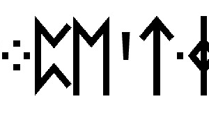

# Achte Forschungsserie: Quellengetreue Wortgrenzen und Wortscore

Stand (UTC): 2026-10-19T22:49:29.345701+00:00. **Keine neue Entschlüsselung bestätigt.**

## E026: Trennzeichen und Seitenlayout

Alle 75 kanonischen Seiten wurden mit ursprünglichen Layouttexten, Zeichenoffsets,
Runenpositionen, expliziten Runenaliasen und Nicht-Runenzeichen gespeichert. Die
iddqd-Quelle unterscheidet im eigenen Kopf ausdrücklich Worttrenner, Zeilen und
Seiten. Zeilenschrägstriche und Leerraum erzeugen hier keine Wortgrenze. Bei
zusammengehörigen Kontrollseiten werden Wörter über den Seitenwechsel fortgeführt,
sofern kein explizites Trennzeichen vorliegt. Zahlen und Hashes bleiben erhalten.

54 der 55 unbekannten Runenseiten stimmen zwischen beiden Quellen in Runen und
inneren Segmentgrenzen überein. Auf **LP2-35, Runenoffset 80** enthält relikd
`ᛈᛖ'ᛏ`, iddqd dagegen `ᛈᛖᛏ`. Das nachgeladene Bild aus dem schon gepinnten
scream314-Commit zeigt einen kurzen erhöhten Strich zwischen den letzten beiden
Runen. Die vorhandene relikd-Interpunktion wird dadurch gestützt; beide Lesarten
bleiben im E026-Ergebnis erhalten, die Entscheidung ist separat dokumentiert.



[Bildmanifest](../sources/boundary_image_manifest.json),
[Koordinaten und Entscheidung](../sources/boundary_layout_decisions.json).
Ein visueller Leser, kein vollständiger Bildaudit. Der keilschriftähnliche Kopf bleibt
im Originalbild erhalten und wird hier nicht interpretiert.

Apostrophe trennen in dieser Untersuchung **lexikalische Teilstücke**, passend
zum unveränderten externen Text-Tokenizer: etwa `DON T`. Das behauptet keine
gedruckte Wortgrenze. Ebenso werden die Endsegmente einzeln untersuchter Seiten
wie vollständige Teilstücke bewertet, selbst wenn ein Wort über die Seite hinweg
weitergehen könnte. Diese Randfragment-Annahme ist eine ausdrückliche Grenze des
Scores; innere Zeilenumbrüche erzeugen dagegen keine künstlichen Grenzen.

## E027: Festgelegtes externes Wortmodell

Training ausschließlich auf den elf schon gepinnten Emerson-Essays, ohne Kapitel
II und ohne Liber-Primus-Texte: 64574 Worttokens,
8182 verschiedene Runenwörter. Gegebene
Segmentlänge L, Wort w:

`P(w | L) = (count(w) + 20 Q(w)) / (N_L + 20)`.

Q ist die bisherige externe Viergramm-Kette, am Segmentanfang zurückgesetzt.
Der Gesamtscore ist die Summe der Wort-Logwahrscheinlichkeiten pro Rune. Das
Modell ist für jede feste Länge normalisiert; unbekannte Wörter behalten eine
positive Backoff-Wahrscheinlichkeit. Parameter vorab festgelegt, keine Anpassung
an unbekannte Kandidaten.

Auf denselben 1.600 Veränderungen der acht kanonisch konsistenten Kontrolltexte
bevorzugt der Wortscore den Originaltext **1582**-mal,
der frühere Score **1568**-mal. Dies ist ein
deskriptiver Vergleich korrelierter Veränderungen, kein Signifikanznachweis und
keine blinde historische Validierung. Drei bekannte Schlüsselkontrollen werden
mit allen Phasen beziehungsweise Zahlenstarts und F-Unterbrechungen exakt gefunden.

Die Optimierung speichert innerhalb eines Segments Schlüsselcursor und vollständiges
Teilwort. Erst nach der Wortbewertung werden Pfade mit gleichem Cursor zusammengeführt.
Das deckt sämtliche F-Unterbrechungsteilmengen im angegebenen Suchraum ab, ohne
Beam-Pruning. Kleine vollständige Enumerationen prüfen die DP unabhängig.

## E028: Vollständiger begrenzter Suchraum

812 affine Substitutionen, 381 vorhandene primitive Wortschlüsselzyklen mit allen
Phasen, drei Zahlenströme mit Starts 0–255, vier Vorzeichen und sämtliche
F-Unterbrechungsteilmengen. Im vollständigen Verbund werden vier bekannte Texte
exakt als bestes Ergebnis gefunden. Danach alle 55 unbekannten Runenseiten
untersucht. Die reine Zahlenseite LP2-50 ist erhalten, aber kein Runeninput.
Dies wiederholt bekannte Chiffrenfamilien mit geändertem Score; keine neue Familie.

Stärkster Kandidat: LP2-55, Score -5.696945.
Unveränderte Transliteration, durch die festen Quellsegmente getrennt:

```text
I GNDI UG AN EASNGEOEOS PUIGSL LW OBFAFORLTHEJRS CRRBYF LDUS THTH THREATRME RROENGSNGU LO AEOPCDA PAR OWL
```

3 von 19 unabhängigen Nulltexten erreichen mindestens diesen Score;
Plus-eins-p=0.200, Bonferroni über 55 Seiten=1.000. Segmentpositionen
und -längen bleiben fest, ebenso Runenhäufigkeiten und gleiche Nachbarpaare.
Jeder Nulltext durchläuft den gesamten identischen Suchraum. Die Auswahl wurde
vor den Nulltests eingefroren. 19 Replikate reichen nicht zur Auflösung korrigierter
Signifikanz; null Überschreitungen würden eine größere vorab registrierte Prüfung
verlangen. Kein neuer Klartext bestätigt.

## E029: Begrenzte Prüfung einer öffentlichen Lösungsmeldung

Eine [öffentliche Meldung](https://www.reddit.com/r/mystery/comments/1x0432x/proof_5_new_liber_primus_pages_solved/)
behauptet mehrere neue Lösungen. In den untersuchten Abschnitten des verlinkten
[Projekts](https://21skibidiserb37.gitlab.io/xyzsolving333/) steht derselbe Byte-Digest
wie in E023; unsere Bytefolge stimmt damit mit einer öffentlich angegebenen
Folge überein. Eine historische Priorität ist durch den aktuellen Abruf nicht belegt.
Auch die angegebenen arithmetischen Fakten stimmen: 11 hat modulo 29 Ordnung 28,
die Fibonacci-Paarfolge modulo 29 kehrt nach 14 Schritten zurück. Beides wurde
unabhängig nachgerechnet, liefert aber keinen unbekannten Klartext. LP2-56/57
sind bereits bekannte Kontrolllösungen. 256 Byte Länge allein identifizieren
keinen RSA-Block. Die Herkunft der zusätzlich behaupteten Binärdatei und ihres
abweichenden Digests bleibt ungeprüft; diese Daten werden nicht übernommen.

Nur diese Teilbehauptungen wurden geprüft, kein Gesamturteil über die Website.
Zeitgestempelte HTML-Bytes und SHA-256 liegen im
[Quellenmanifest](../sources/community_claim_2026-10-20/manifest.json).
Der direkte Reddit-Abruf liefert nur eine Client-Hülle; der Beitrag wurde über
das Webwerkzeug gelesen. Fremde Skripte und Binärdateien wurden nicht ausgeführt.
Keine neue Entschlüsselung unabhängig bestätigt.

## Validierung und Fortsetzung

77 Tests bestanden; 180 Kandidaten durch unabhängige Rückverschlüsselung
und direkte Auswertung der Wahrscheinlichkeitsformel geprüft. Alle neuen Ergebnis-
und Abhängigkeitshashes stimmen. Der Bildausschnitt stimmt pixelgenau mit seiner
angegebenen Region im Quellenbild überein. Alte kanonische Daten bleiben unverändert.

78 erfolgreiche Aufgaben, 674.770 Sekunden protokollierte Experimentzeit;
E028 davon 673.000 innerhalb der 850-Sekunden-Grenze. Phasengrenze
900 Sekunden, ein Forschungsprozess. Keine Hintergrundaufgabe läuft weiter.

Als Nächstes: Einfluss der Randfragmente und Apostrophkonvention an vorab getrennten
externen Textausschnitten und bekannten Kontrollen messen. Längere Rückkopplung
braucht weiterhin einen tragfähigen Kontroll- und Nullvergleichsaufwand. Weitere
Textschlüssel werden nicht ohne konkrete Quellenhinweise erweitert.

[Checkpoint](../checkpoints/phase8_complete.json), [Übersicht](../results/phase8_summary.json).
